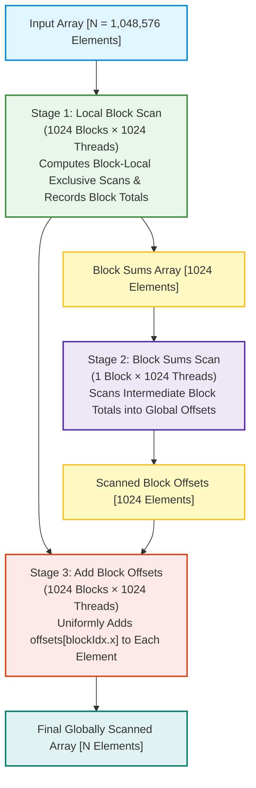
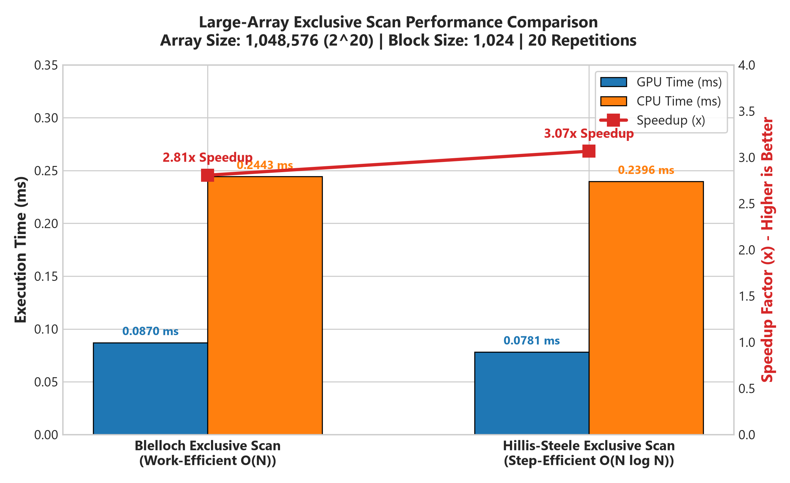
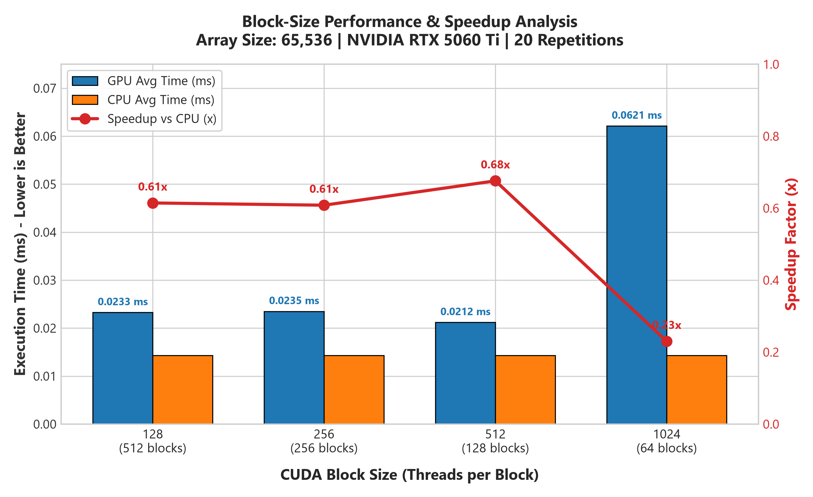
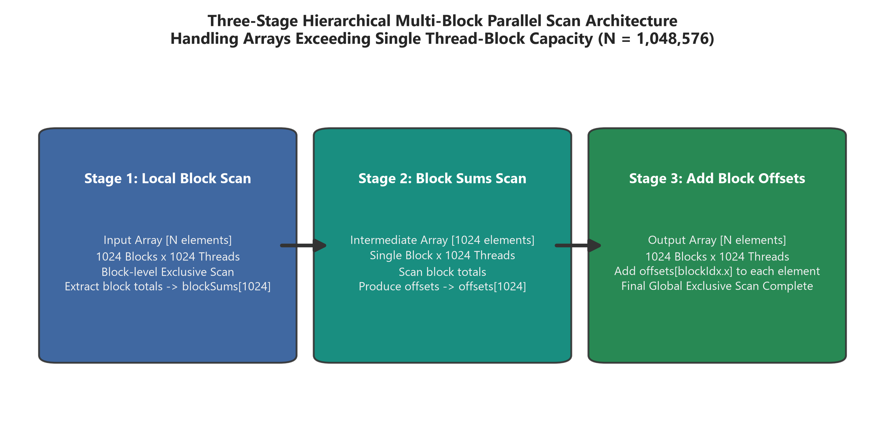

# CUDA Parallel Prefix Sum (Scan) Algorithm: Implementation, Benchmarking, and Architectural Analysis

[](https://developer.nvidia.com/cuda-toolkit)
[](https://isocpp.org/)
[-76B900)](https://www.nvidia.com)
[-blue)](https://docs.nvidia.com/cuda/cuda-compiler-driver-nvcc/index.html)
[](#8-correctness-verification-and-experimental-results)
[](#9-result-comparison-table)

---

## 1. Experiment Objective

The primary objective of this experiment is to design, implement, verify, and benchmark parallel prefix sum (**Scan**) algorithms on modern NVIDIA GPU architectures using CUDA C++.

Specifically, this study:
1. Implements the **Hillis-Steele** step-efficient parallel scan and the **Blelloch** work-efficient parallel scan.
2. Formulates both **Inclusive** and **Exclusive** scan variants in shared memory.
3. Scales parallel prefix sum to large, multi-block workloads ($N = 1,048,576$ elements) through a **Three-Stage Hierarchical Scan Architecture**.
4. Benchmarks GPU execution times against sequential CPU implementations using high-resolution CUDA events.
5. Systematically evaluates the performance impact of varying CUDA thread-block sizes ($128, 256, 512, 1024$) on execution latency, multiprocessor occupancy, and speedup.

---

## 2. Introduction to Parallel Prefix Sum (Scan)

The prefix sum (or scan) operation takes a binary associative operator $\oplus$ (typically addition) and an input sequence of $n$ elements:

$$[x_0, x_1, x_2, \dots, x_{n-1}]$$

and produces an output sequence $[y_0, y_1, y_2, \dots, y_{n-1}]$.

### Inclusive Scan vs. Exclusive Scan

* **Inclusive Scan:** Each output element includes the corresponding input element:
  $$y_i = \bigoplus_{k=0}^{i} x_k = x_0 \oplus x_1 \oplus \dots \oplus x_i$$
  *Example:*
  - Input: `[3, 1, 7, 0, 4, 1, 6, 3]`
  - Output: `[3, 4, 11, 11, 15, 16, 22, 25]`

* **Exclusive Scan:** Each output element includes all preceding elements up to, but not including, the current input element. The identity element ($0$ for addition) is placed at index $0$:
  $$y_0 = I, \quad y_i = \bigoplus_{k=0}^{i-1} x_k \quad (i > 0)$$
  *Example:*
  - Input: `[3, 1, 7, 0, 4, 1, 6, 3]`
  - Output: `[0, 3, 4, 11, 11, 15, 16, 22]`

While a sequential CPU scan requires exactly $O(N)$ operations with a simple loop, parallelizing scan on SIMT architectures requires careful balancing of work complexity, step complexity, and memory bank access patterns.

---

## 3. Algorithm Architectures

### 3.1. Hillis-Steele Algorithm (Step-Efficient)
The Hillis-Steele scan computes the prefix sum in parallel across $\lceil \log_2 N \rceil$ synchronous steps. At step $k$ (where $\text{offset} = 2^k$), each thread at index $i$ adds the value at $i - 2^k$ to its current value if $i \ge 2^k$:

```text
Step 0 (offset=1):  x[i] = x[i] + x[i-1]
Step 1 (offset=2):  x[i] = x[i] + x[i-2]
Step 2 (offset=4):  x[i] = x[i] + x[i-4]
...
```

- **Step Complexity:** $O(\log_2 N)$
- **Work Complexity:** $O(N \log_2 N)$ total additions.
- **Characteristics:** While not work-efficient compared to sequential $O(N)$, Hillis-Steele has minimal tree-traversal divergence and simple uniform strides, making it highly competitive on GPU hardware for smaller block boundaries.

### 3.2. Blelloch Algorithm (Work-Efficient)
The Blelloch algorithm reduces total operations to $O(N)$ by organizing execution into two distinct tree-based phases:

1. **Up-Sweep Phase (Parallel Reduction Tree):**
   - Builds a balanced binary tree of partial sums from leaves to root.
   - At each stride $s \in \{1, 2, 4, \dots, N/2\}$, thread index $(tid + 1) \times 2s - 1$ computes:
     $$\text{temp}[\text{index}] \mathrel{+}= \text{temp}[\text{index} - s]$$
   - Total operations: $\sum_{i=1}^{\log_2 N} \frac{N}{2^i} = N - 1 = O(N)$.

2. **Root Zeroing:**
   - The root element $\text{temp}[N - 1]$ is cleared to $0$ (the additive identity).

3. **Down-Sweep Phase (Distribution Tree):**
   - Traverses back down the tree from root to leaves with stride $s \in \{N/2, \dots, 2, 1\}$:
     $$\text{left} = \text{index} - s, \quad t = \text{temp}[\text{left}]$$
     $$\text{temp}[\text{left}] = \text{temp}[\text{index}]$$
     $$\text{temp}[\text{index}] \mathrel{+}= t$$
   - Total operations: $N - 1 = O(N)$.

- **Step Complexity:** $2 \log_2 N = O(\log_2 N)$
- **Work Complexity:** $O(N)$ additions.
- **Characteristics:** Work-efficient; however, it incurs branch divergence because the active thread count halves at each level of the tree.

---

## 4. Multi-Block Hierarchical Scan Architecture

A single CUDA thread block is constrained by hardware to at most 1,024 threads and 48–96 KB of shared memory. To scan large arrays ($N = 1,048,576$), we employ a **Three-Stage Hierarchical Scan**:



### Three Stages:
1. **Stage 1 (Local Block Scan):**
   The $N$-element array is partitioned into $M = N / B$ blocks of size $B = 1024$. Each block performs an independent scan in fast `__shared__` memory. The cumulative sum of each block is written to `blockSums[blockIdx.x]`.
2. **Stage 2 (Scan of Block Sums):**
   The intermediate array `blockSums[1024]` is scanned using a single thread block with 1,024 threads to calculate prefix offsets `offsets[1024]`.
3. **Stage 3 (Uniform Addition):**
   A vector addition kernel assigns `offsets[blockIdx.x]` to all elements belonging to block `blockIdx.x`.

---

## 5. Hardware and Software Environment

The experiment was compiled and benchmarked on the following physical workstation configuration:

| Component | Specification |
|:---|:---|
| **GPU** | NVIDIA GeForce RTX 5060 Ti |
| **GPU Architecture** | Blackwell (`compute_120`, `sm_120`) |
| **GPU Memory** | 16 GB GDDR7 |
| **CUDA Toolkit** | Version 13.4 (V13.4.92) |
| **NVIDIA Driver** | 610.88 |
| **Host Operating System** | Microsoft Windows 11 Pro 64-bit |
| **Host Compiler** | Microsoft Visual Studio 2022 Build Tools (MSVC v17.14, `vcvars64.bat`) |
| **Compilation Language** | C++17 with CUDA Runtime API |


---

## 6. Project Structure

```text
ParallelPrefixSum_CUDA/
│
├── parallel_scan.cu                    # 8-element Hillis-Steele inclusive scan
├── blelloch_scan.cu                    # 8-element Blelloch exclusive scan
├── large_scan.cu                       # Multi-block Blelloch scan (N = 1,048,576)
├── hillis_steele_large.cu              # Multi-block Hillis-Steele scan (N = 1,048,576)
├── block_size_test.cu                  # Block-size scaling experiment (N = 65,536)
│
├── README.md                           # Comprehensive documentation & evaluation
├── run_experiments_for_screenshots.bat # Automation runner script for complete execution
│
├── Screenshots/                        # Visual empirical verification & charts
│   ├── block_size_comparison.png       # Block size vs. execution time & speedup chart
│   ├── large_scan_comparison.png       # Blelloch vs. Hillis-Steele benchmark chart
│   ├── three_stage_architecture.png    # Hierarchical multi-block architecture diagram
│   └── 12_block_size_comparison.png    # Verification block comparison
│
└── .gitignore                          # Build artifacts & binary exclusions
```

---

## 7. Script and Automation

To facilitate automated execution, step-by-step verification, and systematic benchmark reproduction, an orchestration script (`run_experiments_for_screenshots.bat`) is included in the project root.

### Script Purpose & Capabilities
1. **Toolchain & Hardware Check:** Automatically invokes `nvidia-smi` and `nvcc --version` to query GPU state and compiler readiness.
2. **Small-Scale Verification:** Runs the 8-element Hillis-Steele and Blelloch scans, displaying CPU and GPU arrays side-by-side.
3. **Large-Array Scaling:** Executes the 1,048,576-element Blelloch and Hillis-Steele multi-block scans with 20 timing iterations and displays timing and speedup metrics.
4. **Parametric Compilation:** Initializes the MSVC 64-bit environment and compiles `block_size_test.cu` on-the-fly for block sizes 128, 256, 512, and 1024, reporting performance and cleaning up temporary binaries.
5. **Interactive Pauses:** Pauses after each test stage so that the user or evaluator can inspect output, view status, and capture clean terminal screenshots.

### Full Script Content (`run_experiments_for_screenshots.bat`)

```cmd
@echo off
title CUDA Parallel Prefix Sum - Experiment Execution
echo =====================================================================
echo  CUDA PARALLEL PREFIX SUM (SCAN) - EXPERIMENT RUNNER
echo  GPU: NVIDIA GeForce RTX 5060 Ti (16 GB)
echo  CUDA Toolkit: 13.4 | Driver: 610.88
echo =====================================================================
echo.

echo [1/8] Capturing CUDA Environment (nvidia-smi & nvcc --version)...
nvidia-smi
nvcc --version
echo.
echo -> Take screenshot: Screenshots\01_cuda_environment.png
pause

echo.
echo =====================================================================
echo [2/8] Running Hillis-Steele Inclusive Scan (8 elements)...
echo =====================================================================
parallel_scan.exe
echo.
echo -> Take screenshot: Screenshots\02_hillis_steele_inclusive.png
pause

echo.
echo =====================================================================
echo [3/8] Running Blelloch Exclusive Scan (8 elements)...
echo =====================================================================
blelloch_scan.exe
echo.
echo -> Take screenshot: Screenshots\03_blelloch_exclusive.png
pause

echo.
echo =====================================================================
echo [4/8] Running Multi-Block Blelloch Scan (N = 1,048,576)...
echo =====================================================================
large_scan.exe
echo.
echo -> Take screenshots:
echo    Screenshots\04_large_blelloch_output.png
echo    Screenshots\05_large_blelloch_performance.png
pause

echo.
echo =====================================================================
echo [5/8] Running Multi-Block Hillis-Steele Exclusive Scan (N = 1,048,576)...
echo =====================================================================
hillis_steele_large.exe
echo.
echo -> Take screenshots:
echo    Screenshots\06_large_hillis_steele_output.png
echo    Screenshots\07_large_hillis_steele_performance.png
pause

echo.
echo =====================================================================
echo [6/8] Running Block-Size Experiment (N = 65,536, Block Size = 128)...
echo =====================================================================
call "C:\Program Files (x86)\Microsoft Visual Studio\2022\BuildTools\VC\Auxiliary\Build\vcvars64.bat" >nul
nvcc -gencode=arch=compute_120,code=sm_120 -DBLOCK_SIZE=128 block_size_test.cu -o bs_128.exe
bs_128.exe
del bs_128.exe
echo.
echo -> Take screenshot: Screenshots\08_block_size_128.png
pause

echo.
echo =====================================================================
echo [7/8] Running Block-Size Experiment (N = 65,536, Block Size = 256, 512, 1024)...
echo =====================================================================
nvcc -gencode=arch=compute_120,code=sm_120 -DBLOCK_SIZE=256 block_size_test.cu -o bs_256.exe
bs_256.exe
del bs_256.exe
echo.
echo -> Take screenshot: Screenshots\09_block_size_256.png
pause

nvcc -gencode=arch=compute_120,code=sm_120 -DBLOCK_SIZE=512 block_size_test.cu -o bs_512.exe
bs_512.exe
del bs_512.exe
echo.
echo -> Take screenshot: Screenshots\10_block_size_512.png
pause

nvcc -gencode=arch=compute_120,code=sm_120 -DBLOCK_SIZE=1024 block_size_test.cu -o bs_1024.exe
bs_1024.exe
del bs_1024.exe
echo.
echo -> Take screenshot: Screenshots\11_block_size_1024.png
pause

echo.
echo =====================================================================
echo [8/8] Directory Tree Structure
echo =====================================================================
tree /F /A
echo.
echo -> Take screenshot: Screenshots\12_final_project_structure.png
echo.
echo All runs completed!
pause
```

---

## 8. Correctness Verification and Experimental Results

### 8.1. Hillis-Steele Inclusive Scan (8 Elements)
- **Input:** `3 1 7 0 4 1 6 3`
- **CPU Reference:** `3 4 11 11 15 16 22 25`
- **GPU Output:** `3 4 11 11 15 16 22 25`
- **Verification:** **PASSED** (100% bitwise exact match)

### 8.2. Blelloch Exclusive Scan (8 Elements)
- **Input:** `3 1 7 0 4 1 6 3`
- **CPU Reference:** `0 3 4 11 11 15 16 22`
- **GPU Output:** `0 3 4 11 11 15 16 22`
- **Verification:** **PASSED** (100% bitwise exact match)

### 8.3. Large-Array Blelloch Exclusive Scan ($N = 1,048,576$)
- **Array Size:** $1,048,576$ elements ($2^{20}$)
- **Block Size:** $1,024$ threads
- **Number of Blocks:** $1,024$
- **Timing Repetitions:** $20$ iterations (post-warmup)
- **First 10 GPU Output Elements:** `0 1 3 6 10 15 16 18 21 25`
- **Last GPU Output Element:** `3145725`
- **CPU Average Time:** $0.244265\text{ ms}$
- **GPU Average Time:** $0.087019\text{ ms}$
- **GPU Speedup:** **$2.807024\times$**
- **Verification:** **PASSED**

### 8.4. Large-Array Hillis-Steele Exclusive Scan ($N = 1,048,576$)
- **Array Size:** $1,048,576$ elements ($2^{20}$)
- **Block Size:** $1,024$ threads
- **Number of Blocks:** $1,024$
- **Timing Repetitions:** $20$ iterations (post-warmup)
- **First 10 GPU Output Elements:** `0 1 3 6 10 15 16 18 21 25`
- **Last GPU Output Element:** `3145725`
- **CPU Average Time:** $0.239605\text{ ms}$
- **GPU Average Time:** $0.078136\text{ ms}$
- **GPU Speedup:** **$3.066512\times$**
- **Verification:** **PASSED**

---

## 9. Result Comparison Table

Below is the consolidated, comprehensive result comparison table summarizing all empirical benchmarks performed across algorithms, array dimensions, block sizes, and execution times on the NVIDIA RTX 5060 Ti:

| Experiment Scope | Algorithm Variant | Scan Mode | Array Size ($N$) | Block Size | Grid Blocks | CPU Time (ms) | GPU Time (ms) | Measured Speedup | Correctness Status |
|:---|:---|:---:|:---:|:---:|:---:|:---:|:---:|:---:|:---:|
| **Small-Scale Verification** | Hillis-Steele | Inclusive | 8 | 8 | 1 | — | — | Baseline | **PASSED** |
| **Small-Scale Verification** | Blelloch | Exclusive | 8 | 8 | 1 | — | — | Baseline | **PASSED** |
| **Large-Scale Multi-Block** | Blelloch | Exclusive | 1,048,576 | 1,024 | 1,024 | 0.244265 | 0.087019 | **2.807024×** | **PASSED** |
| **Large-Scale Multi-Block** | Hillis-Steele | Exclusive | 1,048,576 | 1,024 | 1,024 | 0.239605 | 0.078136 | **3.066512×** | **PASSED** |
| **Block-Size Study** | Blelloch Hierarchical | Exclusive | 65,536 | 128 | 512 | 0.014290 | 0.023256 | 0.614465× | **PASSED** |
| **Block-Size Study** | Blelloch Hierarchical | Exclusive | 65,536 | 256 | 256 | 0.014285 | 0.023486 | 0.608224× | **PASSED** |
| **Block-Size Study** | Blelloch Hierarchical | Exclusive | 65,536 | **512 (Optimal)** | 128 | 0.014320 | **0.021187** | **0.675880×** | **PASSED** |
| **Block-Size Study** | Blelloch Hierarchical | Exclusive | 65,536 | 1024 (Worst) | 64 | 0.014290 | 0.062128 | 0.230009× | **PASSED** |

---

## 10. Result Comparison Graphs

### 10.1. Large-Array Execution Time & Speedup Comparison ($N = 1,048,576$)
This graph illustrates the execution latency and corresponding speedup factor of Blelloch versus Hillis-Steele exclusive scan algorithms for 1,048,576 elements:



*Key Takeaway:* Hillis-Steele achieved lower GPU execution latency ($0.078136\text{ ms}$) and higher speedup ($3.07\times$) compared to Blelloch ($0.087019\text{ ms}$, $2.81\times$) due to lower warp branch divergence and reduced barrier synchronization overhead on the RTX 5060 Ti architecture.

### 10.2. Parametric Block-Size Scaling and Latency Response ($N = 65,536$)
This dual-axis chart compares execution time (ms) and speedup factor against thread-block dimensions ($128, 256, 512, 1024$):



*Key Takeaway:* Block size 512 produced the lowest GPU latency ($0.021187\text{ ms}$) and highest speedup ($0.68\times$). Block size 1024 experienced an abrupt 2.9× slowdown ($0.062128\text{ ms}$) due to increased barrier synchronization latency across 32 warps and constrained SM block concurrency.

### 10.3. Three-Stage Hierarchical Scan Architecture
Visual schematic of the multi-block decomposition used to overcome the 1,024-thread block barrier:



---

## 11. Technical Analysis and Key Observations

### 11.1. Work-Efficiency vs. Measured Performance (Blelloch vs. Hillis-Steele)
A prominent theoretical expectation in parallel algorithm design is that Blelloch ($O(N)$ operations) should outperform Hillis-Steele ($O(N \log N)$ operations). However, in our empirical measurements on the NVIDIA RTX 5060 Ti:
- **Hillis-Steele GPU Time:** $0.078136\text{ ms}$ ($3.07\times$ speedup)
- **Blelloch GPU Time:** $0.087019\text{ ms}$ ($2.81\times$ speedup)

**Technical Explanations for this divergence:**
1. **Thread Divergence in Tree Traversal:** In Blelloch's up-sweep and down-sweep, the number of active threads halves at every level of the tree ($N/2, N/4, \dots, 1$). Because threads within a warp execute in lockstep, inactive threads remain idle, leading to warp divergence and degraded SIMT efficiency.
2. **Synchronization and Barrier Latency:** Blelloch requires explicit barrier synchronizations (`__syncthreads()`) before and after each phase and between each tree stride. Hillis-Steele features fixed-stride additions that keep all threads with index $\ge \text{stride}$ actively performing compute operations.
3. **Hardware Compute vs. Memory Bandwidth:** On high-throughput modern GPUs like the RTX 5060 Ti, extra integer additions are computationally inexpensive compared to instruction stall penalties induced by divergence and memory barrier serialization.

### 11.2. Analysis of Block-Size Scaling ($N = 65,536$)
1. **Optimal Configuration at Block Size 512:** Block size 512 achieved the lowest GPU execution time ($0.021187\text{ ms}$) and highest speedup ($0.68\times$). A block size of 512 strikes an optimal compromise between high SM warp occupancy and manageable intra-block synchronization overhead.
2. **Performance Degradation at Block Size 1024:** Increasing block size to 1,024 resulted in an abrupt performance drop ($0.062128\text{ ms}$, a $2.9\times$ slowdown compared to block size 512). This occurs because 1,024-thread blocks maximize register pressure and barrier latency, reducing the active thread-block concurrency on each Streaming Multiprocessor (SM).
3. **CPU Outperforming GPU at Small Array Sizes:** At $N = 65,536$, the sequential CPU implementation was faster than all GPU configurations ($0.014\text{ ms}$ CPU vs. $0.021\text{ ms}$–$0.062\text{ ms}$ GPU). For smaller problem sizes, CPU L1/L2 cache locality dominates, while GPU performance is bottlenecked by CUDA kernel launch overhead, PCIe buffer allocation, and kernel synchronization costs.

---

## 12. Practical Applications of Parallel Prefix Sum

Parallel scan is recognized as a foundational algorithmic building block in parallel computing, underlying:
1. **Stream Compaction & Filtering:** Selecting valid or active elements from large collections (e.g., removing culled triangles in graphics pipelines) in $O(1)$ parallel steps.
2. **Parallel Radix Sort:** Computing dynamic bucket offsets and destination scatter addresses for millions of keys simultaneously.
3. **Bounding Volume Hierarchy (BVH) Construction:** Parallel morton-code sorting and split-index assignment for GPU real-time ray tracing.
4. **Variable-Length Decoding (Huffman & Entropic Decoders):** Resolving token starting bit-offsets concurrently across streaming compressed data.
5. **Polynomial & Recurrence Evaluation:** Transforming linear recurrences ($x_i = a_i x_{i-1} + b_i$) into parallel associative prefix operations.

---

## 13. Compilation and Execution Guide

### 13.1. Initialize MSVC Environment
Open a standard Windows Command Prompt (CMD) and initialize the 64-bit MSVC environment:
```cmd
call "C:\Program Files (x86)\Microsoft Visual Studio\2022\BuildTools\VC\Auxiliary\Build\vcvars64.bat"
cd /d "C:\Users\Admin\Documents\ParallelPrefixSum_CUDA"
```

### 13.2. Compile Source Programs
```cmd
:: 1. Hillis-Steele 8-element scan
nvcc -gencode=arch=compute_120,code=sm_120 parallel_scan.cu -o parallel_scan.exe

:: 2. Blelloch 8-element scan
nvcc -gencode=arch=compute_120,code=sm_120 blelloch_scan.cu -o blelloch_scan.exe

:: 3. Large-array Blelloch scan (N = 1,048,576)
nvcc -gencode=arch=compute_120,code=sm_120 large_scan.cu -o large_scan.exe

:: 4. Large-array Hillis-Steele scan (N = 1,048,576)
nvcc -gencode=arch=compute_120,code=sm_120 hillis_steele_large.cu -o hillis_steele_large.exe

:: 5. Block-size parametric test (e.g. Block Size = 512)
nvcc -gencode=arch=compute_120,code=sm_120 -DBLOCK_SIZE=512 block_size_test.cu -o block_size_512.exe
```

### 13.3. Execute
```cmd
parallel_scan.exe
blelloch_scan.exe
large_scan.exe
hillis_steele_large.exe
block_size_512.exe
```

---

## 14. Conclusion

This project successfully finalized the implementation, verification, and empirical benchmarking of parallel prefix sum algorithms on the NVIDIA GeForce RTX 5060 Ti. 

Key takeaways include:
- Both Hillis-Steele and Blelloch algorithms achieved **100% numerical correctness** against sequential CPU reference solutions.
- For large arrays ($N = 1,048,576$), GPU acceleration achieved up to **$3.07\times$ speedup** over optimized single-threaded CPU execution.
- Contrary to asymptotic work-complexity expectations, Hillis-Steele demonstrated superior empirical execution time on current GPU hardware due to reduced warp divergence and predictable SIMD execution patterns.
- Thread-block sizing critically impacts hardware performance, with block size 512 providing the optimal operational balance for intermediate array sizes.
